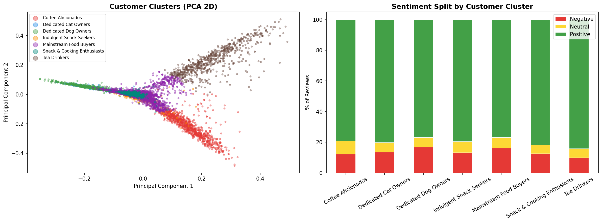
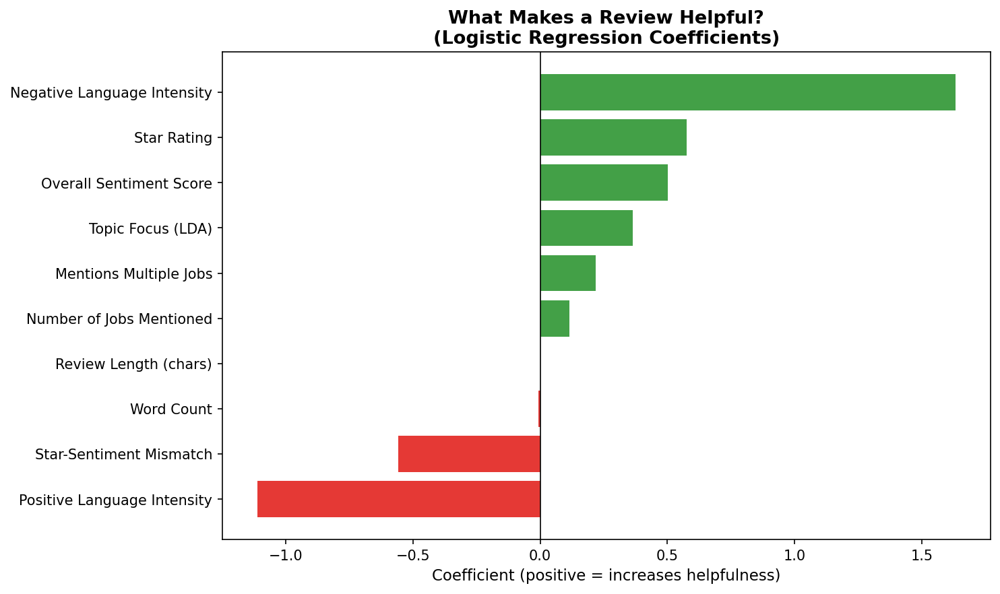
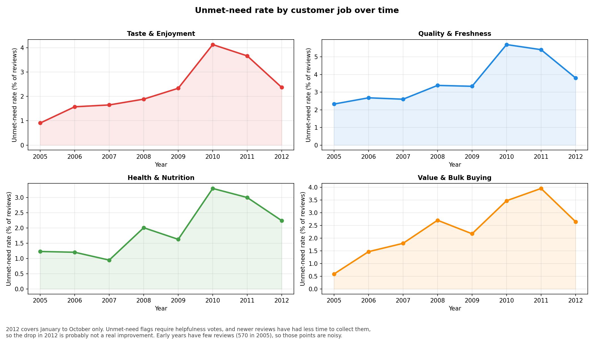

# Voice of Customer Intelligence: Jobs-to-Be-Done on Amazon Food Reviews

I wanted to see what people are actually trying to get done when they buy food online, and where products let them down. I took the Amazon Fine Food Reviews dataset (568,454 reviews, up to Oct 2012) and looked at it through a jobs-to-be-done lens: tag each review with the jobs it mentions (taste, freshness, value, pets), score sentiment, find topics and customer groups, flag unmet needs, and check what makes a review useful to other shoppers.

**One thing up front:** after cleaning I had 560,804 reviews, but I modeled a 100,001-review sample. It has all 44,339 "highly helpful" reviews (5+ votes, 75%+ found it helpful) plus 55,662 random others. Star ratings in the sample look like the full data (78% positive), but helpful reviews are 44% of the sample versus 8% overall. So helpfulness rates here describe the sample, not Amazon.

## What I found

- Taste is the job people mention most and where they get let down most: 72,434 job tags and 2,087 unmet-need reviews. Quality and freshness is second (34,105 tags, 1,490).
- 3.6% of reviews (3,582) are clear unmet-need signals: negative by VADER, 2 stars or less, tagged with a job, and found helpful by 60%+ of voters.
- Dog food stands out. Of the 7 groups K-Means found, the dog group has the highest unmet-need rate (4.9%) against 2.0% to 2.7% for tea, cat, coffee and the snack groups. Tea drinkers are happiest at 4.40 stars.
- Reviews are more likely to be rated helpful when the text and the stars agree. The helpfulness model reaches ROC-AUC 0.827 on a held-out 20%.
- For the four biggest jobs, unmet-need rates climbed from 0.6% to 2.3% in 2005 to 3.3% to 5.7% at the 2010 or 2011 peak. Stars and VADER agree on sentiment 79.5% of the time.

## How I did it

1. Cleaned the data (dropped missing text and repeat reviews of the same product by the same user).
2. Scored sentiment with VADER and compared it to the star rating.
3. Tagged 10 jobs with keyword lists I wrote. A review carries 2.8 jobs on average.
4. Ran LDA (10 topics) and named the topics by hand.
5. Clustered with K-Means on TF-IDF, K=7.
6. Flagged unmet needs with the rule above.
7. Fit a logistic regression for helpfulness, among reviews with 5+ votes.

## What to keep in mind

- The sample isn't random, so don't read helpfulness rates as Amazon-wide.
- The job tags use plain substring matching, so a short keyword like "tea" also fires inside "instead". I haven't measured how often, but Taste and Family tags are probably inflated.
- The groups are text clusters, not verified customer types. One group holds 61.7% of the sample and acts as a catch-all. The elbow curve has no sharp elbow, so K=7 was a judgment call.
- The 2012 drop in the trend chart is probably not real. The data stops in October 2012, and newer reviews had less time to collect helpfulness votes.
- The helpfulness model ranks better than it classifies: it catches 79% of not-helpful reviews, but only 16% of its not-helpful calls are right. Read the coefficient directions, not their sizes.
- This is descriptive. It doesn't say why ratings moved.

**Two label slips in the notebook's own charts** (the notebook is left as it was run):
- The elbow plot is labeled "Chosen K=6", but the model uses K=7. The corrected chart is `Visuals/elbow_plot.png`.
- The trend chart's y-axis says "Negative Review %", but it plots the unmet-need rate. `Visuals/trend_analysis.png` has the right label.

## Files

- `JTBD.ipynb`: the full analysis, written for Colab
- `Data/`: the five CSVs the notebook exports
- `Visuals/`: the charts, plus the elbow plot and word clouds (the word cloud titles show blank boxes where an emoji font was missing)

## Run it

Download `Reviews.csv` from Kaggle (Amazon Fine Food Reviews), put it in Drive at `MyDrive/JTBD/Reviews.csv`, open the notebook in Colab and run it top to bottom. The LDA cell is the slow one.

<!--
Power BI dashboard: add a screenshot as Visuals/dashboard.png, then remove the comment markers around the line below.

-->
